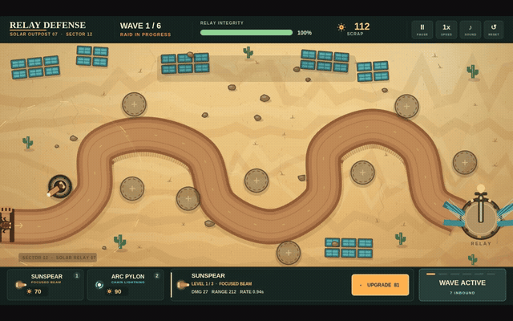
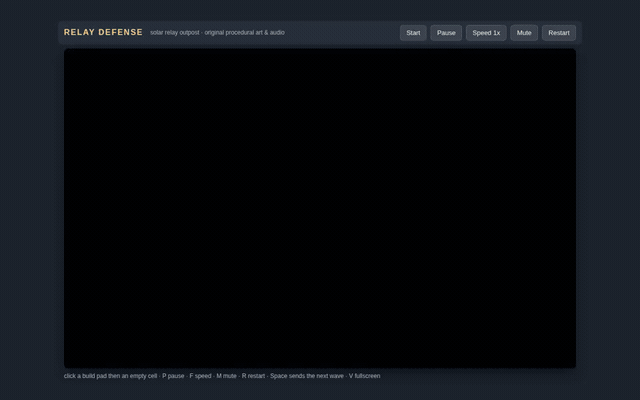
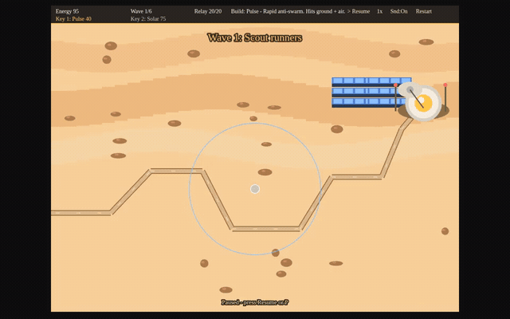
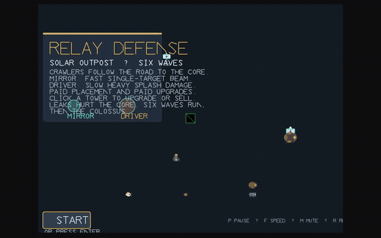
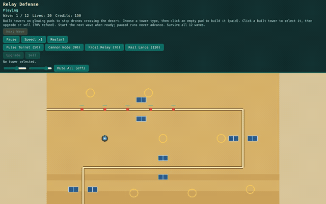

# Relay Defense: two rounds of AI-built games

Part 1 contains six saved browser tower-defense games, generated through different model/runtime/agent workflows. This repository contains their source, static browser bundles and comparison page. Playing requires no language model, API key or home-server access.

**[Play all six games](https://mkhomutskyi.github.io/relay-defense-ai-comparison/)** · [Source and build notes](https://github.com/mkhomutskyi/relay-defense-ai-comparison)

The repository and GitHub Pages site are public. Production reader voting is not enabled. The star interface works locally; the shared rating service requires deployment/configuration. These are different games with different development histories, not a controlled model leaderboard.


The GIF previews below are continuous eight-second real-time gameplay excerpts. The comparison page also includes six compact videos. The Graphify video joins setup and combat with the waiting interval removed; the cut is disclosed beside it. Clips are silent and do not establish client-device frame rate or perceived audio quality.


## Part 2 — six fresh attempts

**[Play or inspect Part 2](https://mkhomutskyi.github.io/relay-defense-ai-comparison/part-2/)** · [Article draft](docs/part-2/ARTICLE_DRAFT.md) · [Measurements](docs/part-2/MEASUREMENTS.md)

The new round adds Qwen Cloud Flash, DeepSeek V4.1 Flash through Ollama, cloud Inkling 2, original local Inkling UD-IQ1_S on RTX 5090, GLM-5.3-Flash and MiniMax M3.1 Flash through Ollama. Five produced playable games, with defects recorded; original local Inkling failed. GLM's provider bill increased by $0.22324 across its initial and visual-feedback phases, totaling 13m18s of active agent time. Personal stars for the new round remain pending. Browser-local ratings/export are available; no shared averages are invented.

These are fresh artifacts with the same creative brief and clean starter. Their reasoning and feedback effort still differ, and earlier timings had a calibration overlap. Sources, relative-base bundles, actual eight-second GIF/video excerpts, original identities and known failures are preserved. The original six below remain unchanged.

## Part 1 — my final ranking

| Place | Development workflow | Creation time / estimate | DeepSeek API usage |
|---|---|---:|---:|
|1|DeepSeek Flash API + Pi + Graphify|26m35s|$0.1847|
|2|DeepSeek Flash API + Pi|21m43s, including a later fix|$0.1446|
|3|Qwen3.8-Flash-Next IQ2_XS + Strata HIP/MTP + Pi|1h58m23s|No local inference API fee|
|4|GLM-5.3-Flash + Strata Q2/Q3 Experts + Pi|5h53m22s|No local inference API fee|
|5|Qwen3.8-Flash-Next IQ2_XS + LM Studio Vulkan + Pi|1h40m19s; playable, map missing|No local inference API fee|
|6|Qwen3.8-27B Q4_K_M + LM Studio Vulkan + Pi, early harness|About 4h10m work (estimated)|No local inference API fee|

API usage includes compatibility preflight; excludes outside coordination, setup, independent QA, human effort, hardware and electricity. Most times sum recorded coding/repair phases. Qwen 27B uses an estimated allocation of 4h10m work plus 4h30m preparation within its original elapsed window; those portions were not timed separately. The 27B harness had significant limitations. GLM used text-only feedback and several recoveries. No general ranking of all local models follows.

Graphify's game won my review. There was one fresh hosted game per configuration. The Graphify session used more in-session API/tool/image work, so the difference cannot be assigned causally to Graphify. Its actual code queries confirmed relationships; no hidden bug discovery or token saving was established.

## Gameplay GIFs and direct play links

Each GIF opens the corresponding browser game. These silent clips show the saved builds, including their defects. Listen to sound in the playable games.

### DeepSeek Flash · Pi + Graphify

[Play this build](https://mkhomutskyi.github.io/relay-defense-ai-comparison/?game=deepseek-graphify)

[](https://mkhomutskyi.github.io/relay-defense-ai-comparison/?game=deepseek-graphify)

### DeepSeek Flash · Pi

[Play this build](https://mkhomutskyi.github.io/relay-defense-ai-comparison/?game=deepseek-pi)

[](https://mkhomutskyi.github.io/relay-defense-ai-comparison/?game=deepseek-pi)

### Flash-Next · Strata · Pi

[Play this build](https://mkhomutskyi.github.io/relay-defense-ai-comparison/?game=qwen-strata)

[](https://mkhomutskyi.github.io/relay-defense-ai-comparison/?game=qwen-strata)

### GLM-5.3-Flash · Strata · Pi

[Play this build](https://mkhomutskyi.github.io/relay-defense-ai-comparison/?game=glm-strata)

[](https://mkhomutskyi.github.io/relay-defense-ai-comparison/?game=glm-strata)

### Flash-Next · LM Studio Vulkan · Pi

[Play this build](https://mkhomutskyi.github.io/relay-defense-ai-comparison/?game=qwen-native)

[](https://mkhomutskyi.github.io/relay-defense-ai-comparison/?game=qwen-native)

### Qwen3.8-27B · Vulkan · Pi

[Play this build](https://mkhomutskyi.github.io/relay-defense-ai-comparison/?game=qwen27)

[](https://mkhomutskyi.github.io/relay-defense-ai-comparison/?game=qwen27)

[GIF source intervals and provenance](results/gif-provenance.json).

## Play locally

```bash
python scripts/serve.py
```

Open `http://localhost:8080`. The committed static bundles run without a model or API key. Five pass TypeScript checks. The native Flash-Next source retains its recorded unused-method error; its Vite-only bundle preserves the playable prototype and its known defects. The missing map has not been repaired. See [build status](results/build-status.json).

## Source and rebuilding

Sources are in `games/<run-id>`. The identifiers label runs, not renamed checkpoints. Five recent games use pinned Phaser 4.2.1 / TypeScript 7.0.2 / Vite 8.3.6; 27B retains its original project dependencies and vendor files. With dependencies installed in each game folder, run:

```bash
node scripts/build.mjs
```

Use the committed lockfile with `npm ci` wherever present. The release records identify any newly generated lockfiles. Build configuration uses a relative Vite base so separate game folders can be served under a repository URL. Original game implementation is unchanged.

## Reader stars

The UI offers 1–5 stars for overall quality and optional visuals, gameplay/fun and sound. Unrated sound is not counted as zero. `ratings/` contains the Worker/D1 API and SQL migration. It replaces a browser token's earlier vote for the same frozen game version and returns averages with counts. This is best-effort anonymous feedback, not verified one-person/one-vote. Do not use repository stars as game scores.

Production requires a D1 database, the real database binding, allowed public origin, deployment/rate-limit configuration and `site/config.json` pointing to the API base. No credentials are shipped. Current disabled-state messaging explicitly says shared votes are not connected. See [deployment notes](docs/DEPLOYMENT.md) and [rating privacy](site/privacy.html).

## Estimated electricity

The current mixed-load illustration budgets 100 W for local coding, 30 W for hosted-workflow tools and 20 W for preparation. The first Qwen window is allocated to an estimated **4h30m preparation + 4h10m Qwen work**, with preparation counted once. At 18.16 cents/kWh, the listed periods total about **1.48 kWh / $0.27 electricity**. These are assumptions, not wall-meter measurements or the complete research bill. Both DeepSeek API charges add $0.3292 separately, giving approximately **$0.60 electricity plus API charges**. See [power evidence, per-phase estimates and scope](docs/ELECTRICITY.md).

DeepSeek still uses local electricity: the estimate includes the AMD box running Pi, tools, builds and browser tests at an assumed 30 W. Hosted inference needs no local AI accelerator or model weights, so an existing computer can avoid an AI-hardware purchase. For Pi's API-client role, 2 vCPUs / 2 GB RAM is a suggested starting allocation, not a tested minimum. A suitable 64-bit Raspberry Pi or Linux container on it is a plausible client host; builds, Graphify and browser automation may need more resources. These smaller setups were not benchmarked. See [client sizing and evidence](docs/ELECTRICITY.md#hosted-inference-still-uses-local-electricity).

## Media, credits and experiment scope

Selected screenshots and clips come from actual browser execution. Silent clips/GIFs do not establish sound quality or client FPS. My ranking is separate from public reader feedback. Codex prepared the comparison UI, rating service, packaging and article graphics; the tested models authored the game implementations.

The machine was a refurbished MINISFORUM AI X1 Pro, Ryzen AI 9 HX 370, 64 GB RAM. The refurbished barebone cost $522.63 including tax. I was lucky to find 64 GB of used DDR5 on eBay for $520. Recorded new spending was $1,042.63; the NVMe drive was reused. Local inference ran on that AMD machine; both DeepSeek arms used hosted inference while tools/builds/browser ran locally. The hardware/setup notes are in [minisforum-hx370-local-ai](https://github.com/mkhomutskyi/minisforum-hx370-local-ai). The [recorded GPU memory layout and limits](docs/GPU_MEMORY.md) explain the 2 GiB preallocated heap, 56 GiB GTT budget and shared-memory constraints.

Keep Phaser/template and dependency license notices. See [credits](docs/CREDITS.md). No weights, credentials, account records, private infrastructure configuration or raw model sessions belong in this repository.

For changes, read [Contributing](CONTRIBUTING.md), the [security policy](SECURITY.md) and the [MIT License](LICENSE). Run `python scripts/check_public.py` before submitting. It checks privacy patterns, both exact captured/published source representations and all six GIF/source hashes; GitHub runs the same check on pushes and pull requests. The original source capture and Git's line-ending-normalized snapshot are recorded separately in `results/source-hashes.json` and `results/git-source-hashes.json`.
