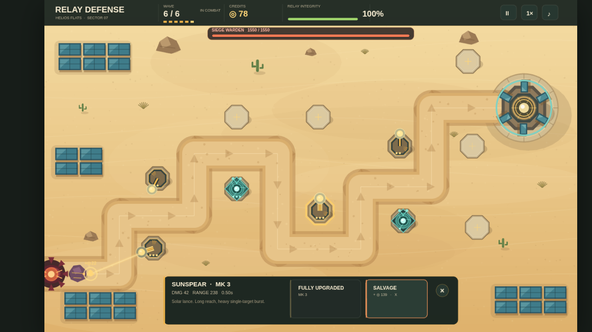
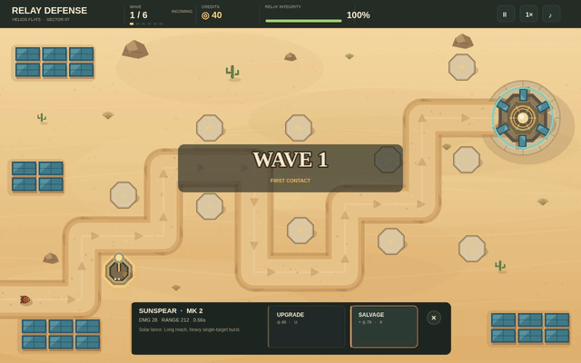

# Relay Defense: six AI-built games

Six saved browser tower-defense games, generated through different model/runtime/agent workflows. This repository contains their source, static browser bundles and comparison page. Playing requires no language model, API key or home-server access.

**Preparation status:** private review candidate. Public GitHub Pages and production reader voting are not enabled. The star interface works locally; the shared rating service requires deployment/configuration. These are different games with different development histories, not a controlled model leaderboard.





The GIF is a continuous real-time combat excerpt. The comparison page also includes six compact videos. The Graphify video joins setup and combat with the waiting interval removed; the cut is disclosed beside it. Clips are silent and do not establish client-device frame rate or perceived audio quality.

## Owner's final preference

| Place | Development workflow | Recorded creation time | DeepSeek API usage |
|---|---|---:|---:|
|1|DeepSeek Flash API + Pi + Graphify|26m35s|$0.1847|
|2|DeepSeek Flash API + Pi|21m43s, including a later fix|$0.1446|
|3|Qwen3.8-Flash-Next IQ2_XS + Strata HIP/MTP + Pi|1h58m23s|No local inference API fee|
|4|GLM-5.3-Flash + Strata Q2/Q3 Experts + Pi|5h53m22s|No local inference API fee|
|5|Qwen3.8-Flash-Next IQ2_XS + LM Studio Vulkan + Pi|1h40m19s; unfinished|No local inference API fee|
|6|Qwen3.8-27B Q4_K_M + LM Studio Vulkan + Pi, early harness|About 8h40m wall span|No local inference API fee|

API usage includes compatibility preflight; excludes outside coordination, setup, independent QA, human effort, hardware and electricity. Most times sum coding/repair phases; 27B is a broader wall span. The 27B harness had significant limitations. GLM used text-only feedback and several recoveries. No general ranking of all local models follows.

Graphify's game won the owner's review. There was one fresh hosted game per configuration. The Graphify session used more in-session API/tool/image work, so the difference cannot be assigned causally to Graphify. Its actual code queries confirmed relationships; no hidden bug discovery or token saving was established.

## Play the prepared site locally

```bash
python scripts/serve.py
```

Open `http://localhost:8080`. The committed static bundles are ready for review. Five pass TypeScript checks. The native Flash-Next source retains its recorded unused-method error; its Vite-only bundle preserves that incomplete browser artifact. The missing map has not been repaired. See [build status](results/build-status.json).

## Source and rebuilding

Sources are in `games/<run-id>`. The identifiers label runs, not renamed checkpoints. Five recent games use pinned Phaser 4.2.1 / TypeScript 7.0.2 / Vite 8.3.6; 27B retains its original project dependencies and vendor files. With dependencies installed in each game folder, run:

```bash
node scripts/build.mjs
```

Use the committed lockfile with `npm ci` wherever present. The release records identify any newly generated lockfiles. Build configuration uses a relative Vite base so separate game folders can be served under a repository URL. Original game implementation is unchanged.

## Reader stars

The UI offers 1–5 stars for overall quality and optional visuals, gameplay/fun and sound. Unrated sound is not counted as zero. `ratings/` contains the Worker/D1 API and SQL migration. It replaces a browser token's earlier vote for the same frozen game version and returns averages with counts. This is best-effort anonymous feedback, not verified one-person/one-vote. Do not use repository stars as game scores.

Production requires a D1 database, the real database binding, allowed public origin, deployment/rate-limit configuration and `site/config.json` pointing to the API base. No credentials are shipped. Current disabled-state messaging explicitly says shared votes are not connected. See [deployment notes](docs/DEPLOYMENT.md) and [rating privacy](site/privacy.html).

## Media, credits and experiment scope

Selected screenshots and clips come from actual browser execution. Silent clips/GIFs do not establish sound quality or client FPS. Owner preference is separate from public reader feedback. The comparison UI, rating service, packaging and article graphics are coordinator-authored infrastructure, not model-generated game output.

The machine was a refurbished MINISFORUM AI X1 Pro, Ryzen AI 9 HX 370, 64 GB RAM. Historical outlay: $1,042.63 including tax/RAM, with a reused NVMe drive. Local inference ran on that AMD machine; both DeepSeek arms used hosted inference while tools/builds/browser ran locally. The hardware/setup notes are in [minisforum-hx370-local-ai](https://github.com/mkhomutskyi/minisforum-hx370-local-ai).

Keep Phaser/template and dependency license notices. See [credits](docs/CREDITS.md). No weights, credentials, account records, private infrastructure configuration or raw model sessions belong in this repository.
